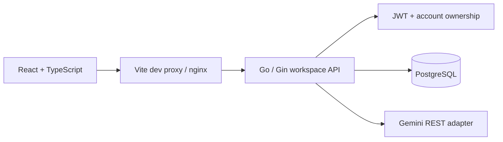

# Architecture

## Runtime flow

The frontend is a feature-oriented single-page app. Material UI owns interactive controls, focus behavior, dialogs, and theme primitives; CSS owns the product layout and illustration. TanStack Query owns remote state. Component state holds drafts and pending UI; sessionStorage holds the current tab's auth. No private twin/session selection is shared across accounts through localStorage.

The backend is a small modular monolith. A composition root injects the database, provider interface, secret, and allowed origins. The workspace package groups related HTTP operations by resource instead of duplicating constructor-only repository/service layers. Shared transport/configuration concerns stay in platform packages.

## Data model

- `users`: account identity, normalized email, password hash.
- `personalities`: twin ownership, name, language, `slider_json`, style summary. This legacy name is intentional.
- `samples`: writing examples and JSON embeddings; associated by `personality_id`.
- `memories`: explicit personal context, tags, bytea-encoded embedding JSON; associated by `personality_id`.
- `chat_sessions`: user/twin ownership and conversation title.
- `messages`: user/twin text, chronology, retrieved-reference metadata.

UUIDs are generated in Go. Existing tables/primary keys are preserved. No automatic migration runs during API startup. The migration command uses GORM AutoMigrate and is intended to be rehearsed on a database clone before release.

## Chat lifecycle

1. Authenticate, validate input, load the account's twin, and validate any supplied session against both account and twin.
2. Reject an overlapping request for this account/twin within this API process.
3. Embed the message, load the twin's samples/memories, and rank by cosine similarity. Use at most five references and 12 previous messages.
4. Build a separate system instruction and untrusted context/history payload. Call Gemini with provider and request deadlines.
5. After generation succeeds, lock the owning twin and existing session in a transaction. Create the session if needed, save both messages together, and update conversation activity.
6. Return persisted messages and references. Provider failures produce 502 without saving a partial turn. Database failures are logged server-side and return safe errors.

Deletion follows the same lock order so it cannot race a message write into orphaned conversation data. Twin deletion removes its sessions/messages, memories, and samples transactionally. Memory edits also verify that the twin still exists before persistence.

## Design decisions

- **Current React + Material UI:** consistent accessible controls, maintained package APIs, a single theme system. Exact versions are pinned by the lockfile.
- **TypeScript at the HTTP boundary:** checked response and mutation contracts, without a redundant client-side domain layer.
- **Gemini REST interface:** small provider adapter, explicit request deadlines, no dependency on the old deprecated Go SDK, easy test doubles.
- **Curated memory:** predictable privacy and correction behavior; no silent fact extraction or unbounded background workers.
- **Keep PostgreSQL and legacy table names:** lower migration cost and preservation of existing data. Physical folder renames alone would add churn without improving the module boundaries.
- **No streaming yet:** a whole reply and both message writes have a clear atomic success/failure boundary. Streaming needs explicit cancellation and partial-message semantics.

## Scale envelope

Designed for an initial single API instance. Rate limiting and overlapping-send protection are process-local; vector ranking is linear in the selected twin's context size. Before scaling, add shared rate limits/idempotency, cursor pagination, vector indexing, and production observability. See the roadmap.
